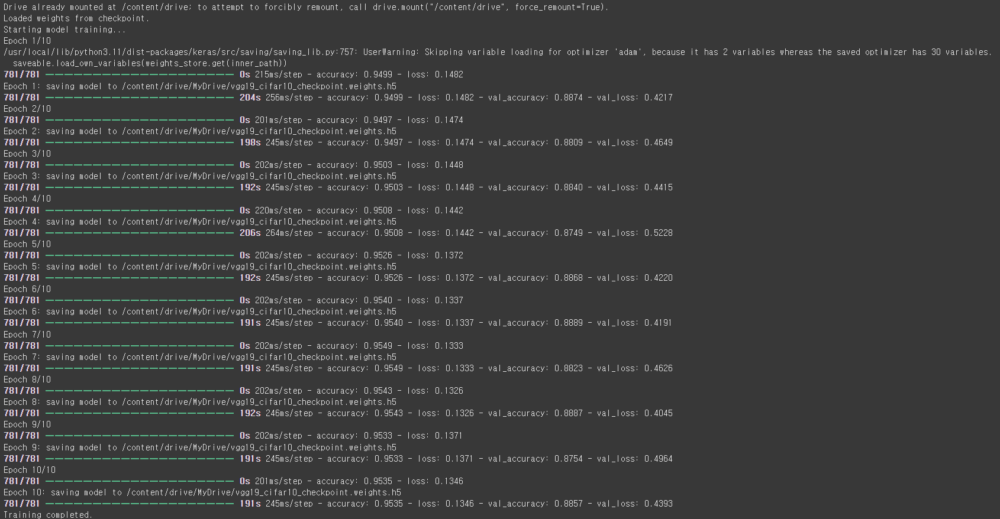
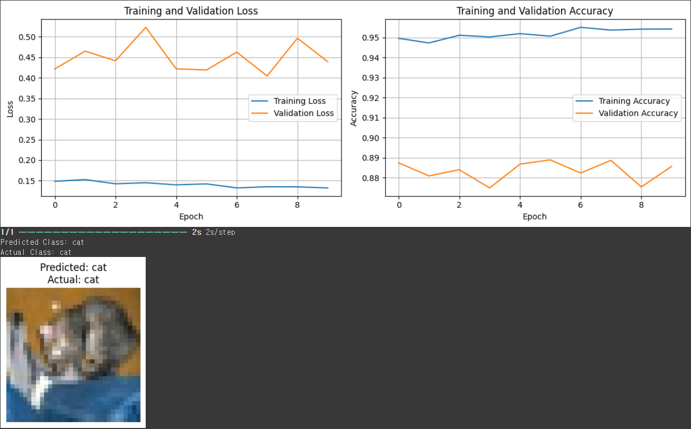
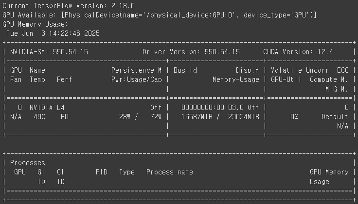
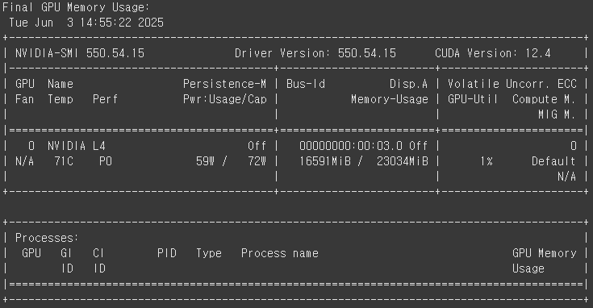
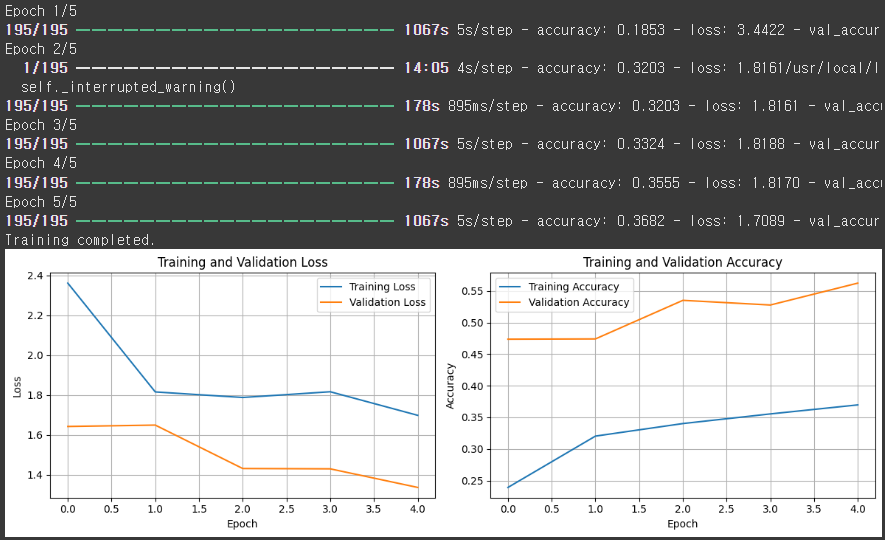

# VGG19 전이학습으로 CIFAR-10 분류

ImageNet으로 사전학습된 **VGG19**를 불러와 CIFAR-10(10개 클래스) 분류에 전이학습했습니다.
같은 작업을 **L4 GPU**와 **TPU** 환경에서 각각 실행했습니다.

- 언어/프레임워크: Python, TensorFlow(Keras), NumPy, Matplotlib
- 실행 환경: Google Colab (L4 GPU / TPU 런타임)
- Claude AI는 github 정리에만 사용, 코드 작성에는 미사용함.

```
src/
  vgg19_l4_gpu.py   # L4 GPU: 마지막 5개 층 미세조정, 체크포인트 저장/이어하기
  vgg19_tpu.py      # TPU: VGG19 전체 동결, 분류기만 학습
results/            # nvidia-smi, 학습 로그, 손실·정확도 그래프, 예측 예시
```

## L4 GPU 버전

`src/vgg19_l4_gpu.py`

- 32×32 이미지를 배치 단위로 224×224로 키워서 입력
- VGG19(`include_top=False`)의 마지막 5개 층만 학습 → Flatten → Dense(512)+BN → Dropout(0.3) → Dense(10)
- Adam(lr = 1e-4), batch 64, 10 epochs, 매 epoch마다 Google Drive에 가중치 저장 (중단돼도 이어서 학습 가능)

| 학습 로그 | 손실·정확도 + 예측 예시 |
|---|---|
|  |  |

| 시작 시 GPU 메모리 | 종료 시 GPU 메모리 |
|---|---|
|  |  |

**결과:** 학습 정확도 약 95%, 검증 정확도 약 88% 수준. 테스트 이미지 예시(cat)를 맞게 예측했습니다.

## TPU 버전

`src/vgg19_tpu.py`

- 데이터 전체를 224×224로 미리 변환한 뒤 학습, VGG19는 전체 동결



**결과:** 5 epoch 동안 검증 정확도가 약 0.48 → 0.56으로 올랐습니다.

## 실행 방법

두 파일 모두 Google Colab 셀에서 실행하도록 작성되어 있습니다 (`!pip install`, Google Drive 마운트 사용).
Colab에서 런타임 유형을 L4 GPU 또는 TPU로 바꾼 뒤 코드를 셀에 붙여 넣어 실행합니다.
